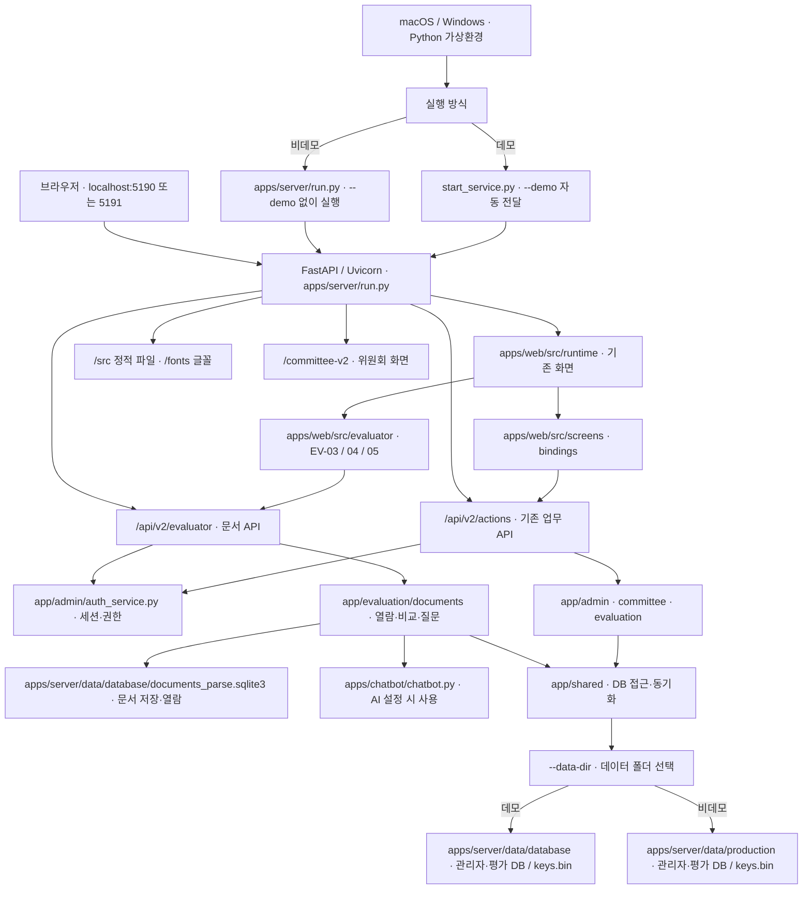

# 심사임당 v0.1

심사임당은 제안요청서 준비부터 평가위원 선정, 평가·제출, 결과 정리까지 돕는 제안평가 업무 지원 프로젝트입니다. 현재 통합 서비스는 Python FastAPI/Uvicorn 한 프로세스가 화면과 API를 제공합니다. 화면 시안과 기능별 작업 폴더는 별도로 보존합니다.

**실행 안내:** 데모 계정으로 체험하려면 데모 실행 명령을 사용하고, 비데모에서는 비어 있는 별도 DB에 계정·사업을 등록해야 합니다. 추가된 제안요청서 기능과 제공받은 폴더의 필요 여부는 [서비스 구성도](SERVICE_ARCHITECTURE_AND_RUN.md#추가된-제안요청서-기능-구성도)에 정리했습니다.

```text
제안요청서 등록 → 평가기준 확인 → 제안서 등록 → 평가위원 선정 → 평가·제출 → 결과 정리 → 결과 확정·보고
```

## 팀원과 담당 기능

| 팀원 | 주로 맡은 일 | 코드 폴더 |
|---|---|---|
| **원준석 PM · Lex6won** | 기획과 일정 조율, 평가위원 등록·선정·배정 | [위원 관리](apps/committee_Lex6won/) |
| **오대웅 · DaeUng79** | HWPX 문서 읽기·저장, 요구사항·평가기준 분석, 문서 챗봇 | [문서 처리](apps/documents/), [챗봇](apps/chatbot/) |
| **현수환 · cookiesh1** | 사업·위원·평가·결과를 보여 주는 웹 화면 | [웹 화면](apps/web_cookiesh1/) |
| **김유진 · u-jing** | 점수와 의견 저장, 평가 제출, 결과 정리·보고 | [평가·결과](apps/evaluations_u-jing/) |

각 담당 폴더는 기능별 작업 공간입니다. 다른 팀원도 담당자와 상의해 함께 수정할 수 있습니다.

# 현재 서비스 구조와 실행 방법

이 안내는 현재 `apps/server`, `apps/web`, `apps/documents`, `apps/chatbot`으로 구성된 **단일 Python 서비스**를 설명합니다. `npm`이나 별도 Vite 서버 없이 FastAPI/Uvicorn이 화면과 API를 함께 제공합니다. 기본 포트는 `5190`이며 다른 서비스가 사용 중이면 `--port 5191`처럼 지정합니다. 실행 상태는 서버 프로세스에서 확인합니다.

김유진 변경파일의 EV-03·04·05 기능을 통합했고, 문서·챗봇 모듈 폴더 이름을 `documents`, `chatbot`으로 정리했습니다. 아래에 사용 범위와 데이터 연결 조건을, [검증 절](#확인한-동작과-검증-범위)에 당시 확인 결과와 한계를 정리했습니다.

## 서비스 구성도



### 요청과 데이터의 흐름

1. `/`은 역할 선택 화면인 `/app/entry/design/entry.html`로 이동합니다. `design_runtime.py`가 `apps/web/src/runtime`의 원본 화면에 `screens`와 `bindings`의 기능 코드를 연결합니다.
2. 로그인과 화면 버튼은 `/api/v2/actions/{action_id}`로 요청합니다. `web_api.py`가 요청·세션을 확인하고 `gateway.py` 또는 위원회 액션 게이트웨이를 통해 업무 함수에 전달합니다.
3. 관리자·위원회 기능은 주로 `admin.sqlite3`, 평가·결과 기능은 `evaluation.sqlite3`를 사용합니다. 두 DB 간 자료 전달은 `app/shared/sync_service.py`의 outbox/inbox 방식으로 처리합니다. `keys.bin`은 기존 암호화 데이터와 함께 유지해야 합니다.
4. `/committee-v2/`는 `apps/server/app/committee/web_v2`를 제공합니다. `/src`와 `/fonts`는 `apps/web`에서 제공합니다. 시안 폴더 `apps/web_cookiesh1/v2`는 서비스에 포함하지 않으며 `/v2/` 경로는 제공하지 않습니다.
5. EV-03·04·05는 기존 화면에 `/src/evaluator` 모듈을 연결합니다. `/api/v2/evaluator`는 기존 로그인 쿠키와 위원·사업·참석·회차 권한을 검사한 뒤 문서 DB의 고정 버전을 읽습니다. 별도 8002 서버나 Vite는 필요하지 않습니다. 점수와 의견 저장은 기존 액션 API를 유지합니다.
6. `/api/v2`의 `v2`는 API 버전 이름입니다. `apps/web_cookiesh1/v2` 시안 폴더는 서비스에 사용하지 않습니다. 데모와 비데모는 같은 화면·업무 코드를 사용하며, `--demo` 시드 실행 여부와 데이터 폴더가 다릅니다.

### 평가위원 문서 열람·비교·도우미

| 화면 | 통합된 기능 | 주요 코드 |
|---|---|---|
| EV-03 제안요청서 | 본문·표·그림, 제목 기반 목차와 쪽 이동, 원본 내려받기 | `apps/web/src/evaluator/EV-03`, `apps/server/app/evaluation/documents/rfp_api.py` |
| EV-04 제안서 | 평가 회차에 고정된 업체별 제안서 열람과 원본 내려받기 | `apps/web/src/evaluator/EV-04`, `apps/server/app/evaluation/documents/proposal_api.py` |
| EV-05 비교·질문 | 확정 평가항목별 비교, 근거 쪽 열기, 업체별 문서 질문 | `apps/web/src/evaluator/EV-05`, `apps/server/app/evaluation/documents/comparison_api.py` |

화면은 기존 `apps/web/src/runtime`에 연결되며, 문서 요청은 `apps/server/app/api/evaluator_documents.py`의 `/api/v2/evaluator` API가 처리합니다. 기존 로그인 쿠키와 `admin.sqlite3`의 사업·명부, `evaluation.sqlite3`의 회차·참석·참여자 정보를 사용합니다. EV-00·01 로그인·참석과 EV-06·07 점수·의견·서명·결과는 기존 액션 API를 그대로 사용합니다.

평가위원은 해당 사업의 참석 확인 후 제안요청서를 볼 수 있습니다. 제안서·비교·질문은 평가가 열린 회차의 실제 참여자에게 제공됩니다. 다른 사업·회차·업체의 문서에는 접근할 수 없고, 서버는 평가 시작 때 고정한 문서 ID와 파싱 버전을 확인합니다. 문서 참조가 현재 `documents_parse.sqlite3`의 버전과 맞지 않으면 해당 문서를 표시하지 않습니다. EV-03~05의 조회·비교 자체는 문서 DB를 수정하지 않지만, PM-02의 제안요청서 등록은 이 DB에 원본과 파싱 결과를 저장합니다.

본문·표·그림은 저장된 파싱 결과로 표시합니다. 원본 쪽 SVG는 선택 패키지 `pyhwpxlib`가 있을 때 사용할 수 있고, 제목 기반 목차는 문서에 인쇄된 목차를 완전히 복원하지 않을 수 있습니다. 문서 질문은 `apps/chatbot/chatbot.py`와 `apps/documents/step3_ai_requirements_extract_to_SQLite.py`의 블록 압축 함수, `openai`·`tiktoken`·`python-dotenv`, `OPENAI_API_KEY` 설정이 필요합니다. 준비되지 않으면 화면에 안내하고 API는 503을 반환합니다. 질문·답변은 DB에 저장하지 않으며 감사 기록에는 업체와 글자 수 등만 남깁니다. 별도 Vite나 8002 서버는 실행하지 않습니다.

## 실행 파일 구조

```text
simsa-service-v0.1/
├── README.MD                        # 통합 프로젝트 안내
├── start_service.py                  # macOS·Windows 공통 실행기
├── start_simsa_v2.py                 # 이전 명령 호환 실행기
├── start_simsa_v2.cmd                # Windows 선택용 바로가기
├── SERVICE_ARCHITECTURE_AND_RUN.md  # 별도 상세 구성도
└── apps/
    ├── web/
    │   ├── src/
    │   │   ├── runtime/             # 실제 HTML·CSS·JS 화면
    │   │   ├── screens/             # 화면별 기능 연결
    │   │   ├── evaluator/           # EV-03·04·05 문서·비교 기능
    │   │   └── bindings/            # 공통 기능 연결
    │   └── public/
    │       ├── fonts/               # Pretendard GOV
    │       └── index.html           # 선택적 기본 화면
    ├── documents/
    │   ├── hwpx_parser.py          # HWPX 파싱
    │   ├── hwpx_storage.py         # SQLite 저장
    │   ├── rfp_toc.py              # 목차 쪽 연결
    │   ├── step3_ai_requirements_extract_to_SQLite.py
    │   └── requirements.txt        # 문서·AI 선택 의존성
    ├── chatbot/
    │   └── chatbot.py              # AI 답변 모듈
    └── server/
        ├── run.py                    # FastAPI 시작·데모 초기화
        ├── requirements.txt         # 실행 의존성
        ├── app/
        │   ├── api/                  # HTTP 라우팅·액션 매핑·화면 연결
        │   ├── admin/                # 계정·부서·사업·대시보드
        │   ├── committee/            # 후보·선정·명부·위원회 화면
        │   ├── documents/            # apps/documents로 연결하는 import 패키지
        │   ├── evaluation/           # 출석·평가·서명·결과
        │   └── shared/               # DB·데모 데이터·동기화·계약
        ├── contracts/               # 실행 시 읽는 스키마·액션 계약
        ├── fixtures/                # 초기 공통 데이터 SQL
        ├── migrations/
        │   ├── admin/               # 관리자·위원회 DB 변경
        │   └── evaluation/          # 평가 DB 변경
        └── data/
            ├── database/           # 데모 DB · v0.1 압축본에 포함
            │   ├── admin.sqlite3
            │   ├── evaluation.sqlite3
            │   ├── documents_parse.sqlite3 # 문서 파싱 DB · 원본·파싱 결과
            │   ├── projects_delete.sqlite3 # 삭제 사업 이력
            │   ├── keys.bin
            │   ├── access-code.txt
            │   └── sample-manifest.json
            └── production/         # 비데모 실행 시 생성 · 압축본 미포함
                ├── admin.sqlite3
                ├── evaluation.sqlite3
                ├── documents_parse.sqlite3
                ├── projects_delete.sqlite3
                ├── keys.bin
                └── access-code.txt
```

현재 작업 폴더에는 `artifacts/simsa-service-v0.1.zip`이 없습니다. 서비스는 이 작업 폴더에서 실행합니다. 별도 배포본을 만들 때는 `apps/server`, `apps/web`, 필요한 `apps/documents` 데이터와 실행 파일을 함께 담아야 합니다. 현재 기본 데이터 폴더에는 로컬 테스트 관리자 계정 3개가 있고 사업은 없습니다.

## macOS·Windows에서 실행

Python 3.13이 설치된 컴퓨터에서 **서비스 프로젝트 루트**로 이동합니다. 기관 환경에서는 의존성 설치 전에 해당 패키지 게이트를 확인합니다. 가상환경은 컴퓨터마다 생성합니다.

macOS 터미널:

```bash
cd simsa-service-v0.1
python3 -m venv .venv
.venv/bin/python -m pip install -r apps/server/requirements.txt
.venv/bin/python start_service.py --port 5191
# 비데모: 데모 DB와 분리된 빈 데이터 폴더 사용
.venv/bin/python apps/server/run.py --port 5191 --data-dir apps/server/data/production
```

Windows PowerShell:

```powershell
cd simsa-service-v0.1
py -3.13 -m venv .venv
.venv\Scripts\python.exe -m pip install -r apps/server/requirements.txt
.venv\Scripts\python.exe start_service.py --port 5191
# 비데모: 데모 DB와 분리된 빈 데이터 폴더 사용
.venv\Scripts\python.exe apps/server/run.py --port 5191 --data-dir apps/server/data/production
```

위 명령 중 **한 가지 실행 방식만** 선택합니다. 브라우저에서 `http://127.0.0.1:5191/`을 열고, 실행 터미널에서 `Ctrl+C`로 종료합니다. 포트가 비어 있으면 `--port 5191`을 생략해 기본 포트 `5190`을 사용할 수 있습니다. 같은 데이터 폴더로 재실행하면 DB가 유지됩니다.

비데모 폴더는 처음 만들면 관리자·사업·위원 데이터가 모두 비어 있습니다. 계정과 업무 데이터를 등록해야 로그인 및 평가를 진행할 수 있습니다. `--demo`를 빼는 것만으로 운영 데이터나 배포 환경이 마련되는 것은 아닙니다. 문서 DB 기본 위치는 선택한 `--data-dir` 안의 `documents_parse.sqlite3`이며, 기본 데모 경로는 `apps/server/data/database/documents_parse.sqlite3`입니다. 기존 시연 평가 회차의 문서 참조는 문서 DB의 파싱 버전과 일치하는지 별도로 확인해야 합니다. 2026-10-18 최초 통합 당시 확인한 참조 3건은 모두 불일치했으며, 이후 등록한 제안요청서의 신규 참조와는 구분해야 합니다.

### 실행 옵션

`start_service.py`는 현재 명령을 실행한 Python(`sys.executable`)으로 `apps/server/run.py`를 실행하며 `--local-test-login`을 전달합니다. 데모 사업은 생성하지 않고 현재 데이터 폴더에 저장된 로컬 테스트 계정의 로그인 입력만 돕습니다. 서버의 기본 포트는 `5190`, 데이터 폴더는 `apps/server/data/database`입니다. 프런트엔드는 같은 FastAPI 서버가 제공하므로 `npm run dev`는 필요하지 않습니다.

| 옵션 | 의미 |
|---|---|
| `--demo` | 명시적으로 전달할 때만 가상 계정·시연 사업 데이터를 생성합니다. |
| `--local-test-login` | 저장된 로컬 테스트 계정의 로그인 입력을 돕습니다. `start_service.py`가 자동으로 전달합니다. |
| `--original-ui` | `apps/web/src/runtime`의 원본 화면에 기능 코드를 연결합니다. 현재 서버의 기본값도 `True`라 명시하지 않아도 같습니다. |
| `--port 5190` | 로컬 서버 포트입니다. `--port 5191`처럼 변경할 수 있습니다. |
| `--data-dir 경로` | SQLite DB, `keys.bin`, `access-code.txt`를 저장·읽을 폴더입니다. 데모와 비데모 폴더를 분리합니다. 기존 데이터를 이동할 때는 DB와 키를 함께 유지합니다. |
| `--samples 경로` | 선택 사항인 샘플 문서 폴더입니다. 기본 실행에는 필요하지 않습니다. |
| `--documents-db 파일` | 문서 파싱·원본 저장 SQLite를 연결합니다. 생략 시 `EVAL_DOCUMENTS_DB_PATH`, 그다음 선택한 `--data-dir`의 `documents_parse.sqlite3`를 사용합니다. 상대 경로는 프로젝트 루트 기준입니다. |

PM-02 제안요청서 HWPX 업로드는 메인 서비스의 `/api/v2/projects/{id}/rfp`가 처리합니다. 원본·파싱 결과와 업로드 이력을 문서 DB에 저장하고, 평가위원용 고정 버전을 평가 DB에 연결합니다.

**2026-10-18 보완:** 업체별 제안서 등록(HWPX·HWP·PDF·PPTX), 평가표 초안·검토·확정(PM-03), 결과 자료 보관(SA-04), 공식 집계표 xlsx, 정원 5~9·예비 1~3 규칙, 위원 제출 오류 수정을 반영했습니다. 내용과 검증 기록은 [docs/INTEGRATION_2026-10-18.md](docs/INTEGRATION_2026-10-18.md)를 보세요. 가상 운영 데이터는 아래 명령으로 넣습니다(서버를 끈 상태에서, 여러 번 실행 가능).

PM-01 사업 삭제 이력은 데이터 폴더의 `projects_delete.sqlite3`에 별도로 저장합니다. 삭제 전 사업 정보·사유·사업현황 요약을 보관한 뒤 관리자 DB의 사업·연결 행과 다른 사업에서 사용하지 않는 문서 DB의 원본·파싱 결과를 물리 삭제합니다. 평가 회차가 진행 중이거나 문서 작업 중인 사업은 삭제할 수 없습니다. 평가 DB에는 삭제된 사업의 참조 스냅샷이 남을 수 있습니다. 기존 삭제 표시 사업은 서비스 시작 시 이관하며, 사업목록의 ‘삭제’ 상태에서 이력을 조회할 수 있습니다. SQLite 파일 크기는 행 삭제 직후 줄지 않고 빈 페이지가 재사용됩니다.

```powershell
.venv\Scripts\python.exe apps/server/seed_samples.py --samples "C:\coding\제안요청서, 제안서 샘플"
```

제안서 PDF·PPTX와 AI 초안(요구사항 추출·평가기준 생성·챗봇)은 선택 패키지가 필요합니다(`apps/documents/requirements.txt`의 `pypdf`, `python-pptx`, `openai`, `tiktoken`, `python-dotenv`). 목차 수정과 근거 연결(PM-08)은 아직 연결되지 않았습니다.

과거 실행 코드에 있던 `os.execv(...)`는 현재 사용하지 않습니다. `start_service.py`는 운영체제별 Python 경로를 고정하지 않고 `sys.executable`과 `subprocess.run`을 사용합니다.

### 로컬 테스트 로그인

| 역할 | 계정 또는 이름 | 비밀번호 또는 휴대전화 뒤 4자리 |
|---|---|---|
| 총괄관리자 | `super-demo` | `DemoOnly!2026` |
| 사업담당자 | `web-demo` | `DemoOnly!2026` |
| 다른 부서 관리자 | `other-demo` | `DemoOnly!2026` |

`seed_samples.py`를 실행하면 가상 위원 72명이 더해집니다(이름·휴대전화는 `apps/server/app/shared/sample_pool.py`). 사업별로 명단을 확정한 뒤에는 그 위원의 이름과 휴대전화 뒤 4자리로 로그인합니다(PM-07 위원 풀 화면에서 확인).

이 세 계정은 현재 기본 데이터 폴더에 저장돼 있으며 `--demo` 없이 로그인할 수 있습니다. 평가위원 테스트 계정은 이번 초기화에서 제거됐습니다. DB와 `keys.bin`은 함께 유지해야 합니다.

## 확인한 동작과 검증 범위

### 평가위원 문서 통합 검증 기록 · 2026-10-18

김유진 변경파일의 EV-03·04·05를 통합할 때 **임시 DB의 독립 통합 테스트 6개**가 통과했습니다. 기존 로그인·로그아웃 세션 공유, 다른 사업·회차·업체 접근 차단, 문서 조회·다운로드, 업체 선택, 본문 검색 근거, 기존 점수 저장, 문서 저장소 미준비 상태와 챗봇 어댑터의 대체 응답을 확인했습니다. 실제 DB·암호화 키·평가 점수는 이 테스트에서 수정하지 않았습니다.

당시 문서 DB의 파싱 버전 3개, 254쪽, 최상위 블록 1,438개를 **읽기 전용**으로 조회해 파서 스키마 호환성을 확인했습니다. 이는 문서가 실제 평가 사업에 연결되었다는 검증은 아닙니다. 같은 시점의 기존 평가 DB 문서 참조 3건은 문서 DB의 `(document_id, parse_revision)`과 불일치했습니다.

별도의 임시 DB와 Chrome에서 로그인 → 제안요청서 파싱 대체 화면 → 업체 전환 → 항목별 비교 → 근거 쪽 열기 → 도우미 미준비 안내 → 기존 평가 화면 복귀를 확인했습니다. 브라우저 JavaScript 예외는 0건이었습니다. 이 검증은 macOS에서 수행했고 Windows 실기기 검증은 하지 않았습니다.

당시 사용한 명령은 `python apps/server/tests/evaluation/test_document_integration.py`와 `python apps/server/tests/evaluation/run_document_browser.py`였습니다. **현재 작업 폴더에는 이 테스트 스크립트와 당시의 `artifacts/evaluator-integration/` 화면 캡처, `evidence/` 기록 파일이 없으므로 그대로 재실행하거나 원본 증적을 확인할 수 없습니다.** 이 문단은 당시 통합 기록을 보존한 것이며 이번 README 수정에서 테스트를 다시 실행했다는 뜻은 아닙니다.

### 이후 확인 및 한계

폴더 변경 후 같은 6개 테스트가 통과한 기록이 있습니다. 비데모 서버를 별도 빈 DB로 실행했을 때 `demo: false`, 첫 화면 HTTP 200, 관리자·평가 DB 무결성 `ok`, 관리자·사업·위원 0건을 확인했습니다. 이후 제안요청서 업로드·사업담당자 미리보기 기능을 추가했고, 5191 서비스에서 업로드 문서 66쪽의 화면 표시를 확인했습니다.

전체 `gg verify --run-tests`는 npm 테스트 명령 미설정과 당시 Mac 가상환경의 `pytest` 미설치로 `blocked`였습니다. `openai==3.23.0` 설치 게이트는 검사기 부재로 `incomplete`였으며 AI 패키지를 새로 설치하거나 실제 AI 요청을 보내지 않았습니다. 개별 동작 확인은 전체 인수검증이나 운영 배포 검증을 뜻하지 않습니다. 기존 ZIP 배포본에도 이 통합 변경은 포함되지 않았습니다.


## 배포 압축본 안내

현재 작업 폴더에는 `artifacts/simsa-service-v0.1.zip`이 없습니다. 배포 압축본을 새로 만들 때는 추가된 제안요청서 업로드·미리보기 코드와 문서 DB의 포함 여부를 확인해야 합니다. 데모 DB와 `keys.bin`을 포함한다면 함께 보관하고 접근을 제한하세요.

`README_v0.2.md`는 이전 v0.2 압축본 안의 안내 파일이었습니다. 그 실행 안내를 위의 macOS·Windows 명령과 데이터 주의사항에 합쳤습니다. v0.2 압축본은 과거 산출물로 남겨 두며, 현재 프로젝트 버전은 **v0.1**입니다.

## 함께 개발하기

1. GitHub에서 [팀 저장소](https://github.com/DaeUng79/5topilot_team)를 내 계정으로 Fork(복사)합니다.
2. 작업을 시작하기 전에 팀 저장소의 최신 내용을 가져와 새 작업 브랜치를 만듭니다.
3. 담당 폴더에서 작업하고 관련 테스트를 실행합니다.
4. 개별 폴더에 개인의 README에 작업 기록을 남기고 팀 저장소에 Pull Request(PR, 변경 검토 요청)를 보냅니다.
5. 다른 팀원의 검토를 받은 뒤 병합합니다.

```bash
git clone https://github.com/<내 GitHub 계정>/5topilot_team.git
cd 5topilot_team
git remote add upstream https://github.com/DaeUng79/5topilot_team.git
git fetch upstream
git switch -c feat/<작업 이름> upstream/main
```

코드가 내 컴퓨터에서 동작함, PR을 보냄, 팀 저장소에 병합됨, 전체 인수검증을 통과함은 서로 다른 상태입니다.
각 상태와 확인 결과는 작업 기록 또는 Pull Request에 구분해 남깁니다.

## 꼭 지켜 주세요

- `.env` 파일, API 키, DB 비밀번호, 실제 제안서, 개인 정보는 GitHub에 올리지 않습니다.
- 테스트에는 실제 사람이나 회사 자료 대신 공개된 자료 또는 사용 허가를 받은 자료를 씁니다.
- AI 결과는 초안일 수 있으니 원문을 확인합니다.
