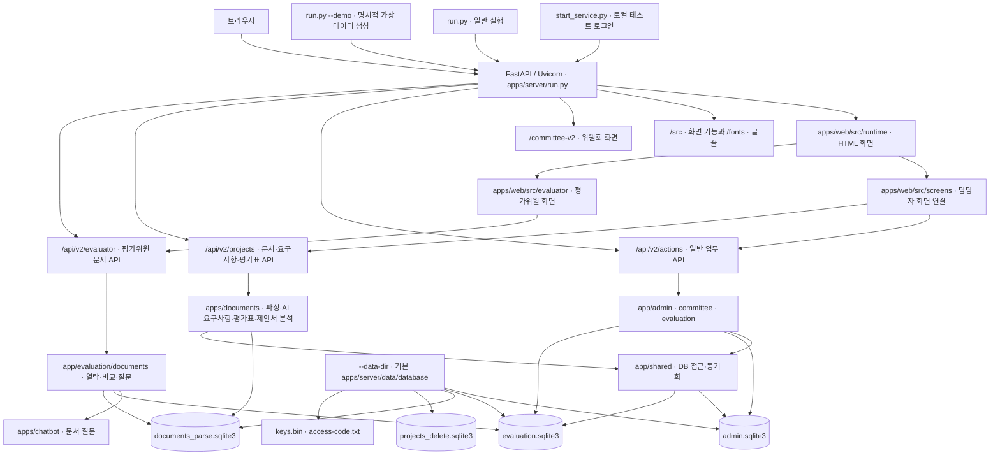

# 심사임당 v0.1

심사임당은 제안요청서 준비부터 평가위원 선정, 평가·제출, 결과 정리까지 돕는 제안평가 업무 지원 프로젝트입니다.

**실행 안내:** `start_service.py`는 기존 로컬 테스트 계정의 로그인 입력을 돕고, 데모 사업은 만들지 않습니다. 가상 사업을 생성하려면 `apps/server/run.py --demo`를 명시합니다. 운영에는 별도 데이터 폴더와 계정 준비가 필요합니다. 현재 연결은 아래 [서비스 구성도](#서비스-구성도)를 참고하세요.

```text
제안요청서 등록 → 요구사항 분석·필요 시 명세서 검토 → 평가기준 확인 → 제안서 등록 → 평가위원 선정 → 평가·제출 → 결과 정리 → 결과 확정·보고
```

## 팀원과 담당 기능

| 팀원                           | 주로 맡은 일                                             | 코드 폴더                                         |
| ------------------------------ | -------------------------------------------------------- | ------------------------------------------------- |
| **원준석 PM · Lex6won** | 기획과 일정 조율, 평가위원 등록·선정·배정              | [위원 관리](apps/committee_Lex6won/)               |
| **오대웅 · DaeUng79**   | HWPX 문서 읽기·저장, 요구사항·평가기준 분석, 문서 챗봇 | [문서 처리](apps/documents/), [챗봇](apps/chatbot/) |
| **현수환 · cookiesh1**  | 사업·위원·평가·결과를 보여 주는 웹 화면               | [웹 화면](apps/web_cookiesh1/)                     |
| **김유진 · u-jing**     | 점수와 의견 저장, 평가 제출, 결과 정리·보고             | [평가·결과](apps/evaluations_u-jing/)             |

각 담당 폴더는 기능별 작업 공간입니다. 다른 팀원도 담당자와 상의해 함께 수정할 수 있습니다.

# 현재 서비스 구조와 실행 방법

이 안내는 현재 `apps/server`, `apps/web`, `apps/documents`, `apps/chatbot`으로 구성된 **단일 Python 서비스**를 설명합니다.
`npm`이나 별도 Vite 서버 없이 FastAPI/Uvicorn이 화면과 API를 함께 제공합니다. 기본 포트는 `5190`이며 다른 서비스가 사용 중이면 `--port 5191`처럼 지정합니다. 실행 상태는 서버 프로세스에서 확인합니다.

### 서비스 구성도



### 요청과 데이터의 흐름

1. `/`은 역할 선택 화면인 `/app/entry/design/entry.html`로 이동합니다. `design_runtime.py`가 `apps/web/src/runtime`의 원본 화면에 `screens`와 `bindings`의 기능 코드를 연결합니다.
2. 일반 업무 버튼은 `/api/v2/actions/{action_id}`로, 제안요청서·요구사항·평가표·제안서 기능은 `/api/v2/projects/{id}/...`로 요청합니다. `web_api.py`와 문서 API 라우트가 요청·세션·권한을 확인한 뒤 각 업무 모듈에 전달합니다.
3. 관리자·위원회 기능은 주로 `admin.sqlite3`, 평가·결과 기능은 `evaluation.sqlite3`, 원본·파싱 문서와 AI 분석 결과는 `documents_parse.sqlite3`, 삭제 사업 이력은 `projects_delete.sqlite3`를 사용합니다. DB 간 자료 전달은 `app/shared/sync_service.py`의 outbox/inbox 방식으로 처리합니다. `keys.bin`은 기존 암호화 데이터와 함께 유지해야 합니다.
4. `/committee-v2/`는 `apps/server/app/committee/web_v2`를 제공합니다. `/src`와 `/fonts`는 `apps/web`에서 제공합니다. 시안 폴더 `apps/web_cookiesh1/v2`는 서비스에 포함하지 않으며 `/v2/` 경로는 제공하지 않습니다.
5. EV-03·04·05는 기존 화면에 `/src/evaluator` 모듈을 연결합니다. `/api/v2/evaluator`는 기존 로그인 쿠키와 위원·사업·참석·회차 권한을 검사한 뒤 문서 DB의 고정 버전을 읽습니다. 별도 8002 서버나 Vite는 필요하지 않습니다. 점수와 의견 저장은 기존 액션 API를 유지합니다.
6. `/api/v2`의 `v2`는 API 버전 이름입니다. `apps/web_cookiesh1/v2` 시안 폴더는 서비스에 사용하지 않습니다. `--demo`는 가상 데이터 생성 여부이고, `--data-dir`은 데이터 폴더 선택입니다. 두 옵션은 서로 독립적입니다. 문서 DB는 별도 `--documents-db` 또는 `EVAL_DOCUMENTS_DB_PATH`로 지정할 수도 있습니다.

### 평가위원 문서 열람·비교·도우미

| 화면             | 통합된 기능                                              | 주요 코드                                                                                    |
| ---------------- | -------------------------------------------------------- | -------------------------------------------------------------------------------------------- |
| EV-03 제안요청서 | 원본 쪽 렌더링, 목차와 쪽 이동, 원본 내려받기            | `apps/web/src/evaluator/EV-03`, `apps/server/app/evaluation/documents/rfp_api.py`        |
| EV-04 제안서     | 평가 회차에 고정된 업체별 제안서 원본 쪽 열람과 내려받기 | `apps/web/src/evaluator/EV-04`, `apps/server/app/evaluation/documents/proposal_api.py`   |
| EV-05 비교·질문 | 확정 평가항목별 비교, 근거 쪽 열기, 업체별 문서 질문     | `apps/web/src/evaluator/EV-05`, `apps/server/app/evaluation/documents/comparison_api.py` |

화면은 기존 `apps/web/src/runtime`에 연결되며, 문서 요청은 `apps/server/app/api/evaluator_documents.py`의 `/api/v2/evaluator` API가 처리합니다. 기존 로그인 쿠키와 `admin.sqlite3`의 사업·명부, `evaluation.sqlite3`의 회차·참석·참여자 정보를 사용합니다. EV-00·01 로그인·참석과 EV-06·07 점수·의견·서명·결과는 기존 액션 API를 그대로 사용합니다.

평가위원은 해당 사업의 참석 확인 후 제안요청서를 볼 수 있습니다. 제안서·비교·질문은 평가가 열린 회차의 실제 참여자에게 제공됩니다. 다른 사업·회차·업체의 문서에는 접근할 수 없고, 서버는 평가 시작 때 고정한 문서 ID와 파싱 버전을 확인합니다. 문서 참조가 현재 `documents_parse.sqlite3`의 버전과 맞지 않으면 해당 문서를 표시하지 않습니다. EV-03~05의 조회·비교 자체는 문서 DB를 수정하지 않지만, PM-02의 제안요청서 등록은 이 DB에 원본과 파싱 결과를 저장합니다.

원본 쪽 렌더링을 사용할 수 있으면 그 결과를 표시하고, 실패하면 저장된 파싱 결과로 대체합니다. HWPX 원본 쪽 SVG에는 선택 패키지 `pyhwpxlib`가 필요하고, 제목 기반 목차는 문서에 인쇄된 목차를 완전히 복원하지 않을 수 있습니다. 문서 질문은 `apps/chatbot/chatbot.py`와 `apps/documents/requirements_extract.py`의 블록 압축 함수, `openai`·`tiktoken`·`python-dotenv`, `OPENAI_API_KEY` 설정이 필요합니다. 준비되지 않으면 화면에 안내하고 API는 503을 반환합니다. 질문·답변은 DB에 저장하지 않으며 감사 기록에는 업체와 글자 수 등만 남깁니다. 별도 Vite나 8002 서버는 실행하지 않습니다.

## 실행 파일 구조

```text
simsa-service-v0.1/
├── README.MD                        # 통합 프로젝트 안내
├── start_service.py                  # macOS·Windows 공통 실행기
├── start_simsa_v2.py                 # 이전 명령 호환 실행기
├── start_simsa_v2.cmd                # Windows 선택용 바로가기
├── SERVICE_ARCHITECTURE_AND_RUN.md  # 별도 상세 구성도
└── apps/
    ├── web/
    │   ├── src/
    │   │   ├── runtime/             # 실제 HTML·CSS·JS 화면
    │   │   ├── screens/             # 화면별 기능 연결
    │   │   ├── evaluator/           # EV-03·04·05 문서·비교 기능
    │   │   └── bindings/            # 공통 기능 연결
    │   └── public/
    │       ├── fonts/               # Pretendard GOV
    │       └── index.html           # 선택적 기본 화면
    ├── documents/
    │   ├── parser_hwpx.py          # HWPX 파싱
    │   ├── storage_documents.py         # SQLite 저장
    │   ├── rfp_toc.py              # 목차 쪽 연결
    │   ├── requirements_extract.py
    │   └── parser_pptx.py          # PPTX 본문 추출
    ├── chatbot/
    │   └── chatbot.py              # AI 답변 모듈
    └── server/
        ├── run.py                    # FastAPI 시작·데모 초기화
        ├── requirements.txt         # 실행 의존성
        ├── app/
        │   ├── api/                  # HTTP 라우팅·액션 매핑·화면 연결
        │   ├── admin/                # 계정·부서·사업·대시보드
        │   ├── committee/            # 후보·선정·명부·위원회 화면
        │   ├── documents/            # apps/documents로 연결하는 import 패키지
        │   ├── evaluation/           # 출석·평가·서명·결과
        │   └── shared/               # DB·데모 데이터·동기화·계약
        ├── contracts/               # 실행 시 읽는 스키마·액션 계약
        ├── fixtures/                # 초기 공통 데이터 SQL
        ├── migrations/
        │   ├── admin/               # 관리자·위원회 DB 변경
        │   └── evaluation/          # 평가 DB 변경
        └── data/
            ├── database/           # 데모 DB · v0.1 압축본에 포함
            │   ├── admin.sqlite3
            │   ├── evaluation.sqlite3
            │   ├── documents_parse.sqlite3 # 문서 파싱 DB · 원본·파싱 결과
            │   ├── projects_delete.sqlite3 # 삭제 사업 이력
            │   ├── keys.bin
            │   ├── access-code.txt
            │   └── sample-manifest.json
            └── production/         # 비데모 실행 시 생성 · 압축본 미포함
                ├── admin.sqlite3
                ├── evaluation.sqlite3
                ├── documents_parse.sqlite3
                ├── projects_delete.sqlite3
                ├── keys.bin
                └── access-code.txt
```

현재 작업 폴더에는 `artifacts/simsa-service-v0.1.zip`이 없습니다. 서비스는 이 작업 폴더에서 실행합니다. 별도 배포본을 만들 때는 `apps/server`, `apps/web`, 필요한 `apps/documents` 데이터와 실행 파일을 함께 담아야 합니다. 기본 데이터 폴더는 현재 로컬 작업 사업과 문서를 포함하므로 빈 운영 DB로 취급하지 않습니다.

## macOS·Windows에서 실행

Python 3.13이 설치된 컴퓨터에서 **서비스 프로젝트 루트**로 이동합니다. 기관 환경에서는 의존성 설치 전에 해당 패키지 게이트를 확인합니다. 가상환경은 컴퓨터마다 생성합니다.

macOS 터미널:

```bash
cd simsa-service-v0.1
python3 -m venv .venv
.venv/bin/python -m pip install -r apps/server/requirements.txt
.venv/bin/python start_service.py --port 5191
# 비데모: 데모 DB와 분리된 빈 데이터 폴더 사용
.venv/bin/python apps/server/run.py --port 5191 --data-dir apps/server/data/production
```

Windows PowerShell:

```powershell
cd simsa-service-v0.1
py -3.13 -m venv .venv
.venv\Scripts\python.exe -m pip install -r apps/server/requirements.txt
.venv\Scripts\python.exe start_service.py --port 5191
# 비데모: 데모 DB와 분리된 빈 데이터 폴더 사용
.venv\Scripts\python.exe apps/server/run.py --port 5191 --data-dir apps/server/data/production
```

위 명령 중 **한 가지 실행 방식만** 선택합니다. 브라우저에서 `http://127.0.0.1:5191/`을 열고, 실행 터미널에서 `Ctrl+C`로 종료합니다. 포트가 비어 있으면 `--port 5191`을 생략해 기본 포트 `5190`을 사용할 수 있습니다. 같은 데이터 폴더로 재실행하면 DB가 유지됩니다.

새 데이터 폴더를 처음 만들고 `--demo`를 지정하지 않으면 관리자·사업·위원 데이터가 비어 있습니다. 계정과 업무 데이터를 등록해야 로그인 및 평가를 진행할 수 있습니다. `--demo`를 빼는 것만으로 운영 데이터나 배포 환경이 마련되는 것은 아닙니다. 문서 DB 기본 위치는 선택한 `--data-dir` 안의 `documents_parse.sqlite3`이며, 기본 폴더는 `apps/server/data/database`입니다. 기존 시연 평가 회차의 문서 참조는 문서 DB의 파싱 버전과 일치하는지 별도로 확인해야 합니다. 2026-10-18 최초 통합 당시 확인한 참조 3건은 모두 불일치했으며, 이후 등록한 제안요청서의 신규 참조와는 구분해야 합니다.

### 로컬 PC의 DB 갱신

프로젝트 루트에서 실행한 기본 서비스(`start_service.py`)의 데이터 폴더는 `apps/server/data/database/`입니다. `--data-dir apps/server/data/production`으로 실행했다면 그 폴더가 대상입니다. 관리자·사업 정보는 `admin.sqlite3`, 평가 정보는 `evaluation.sqlite3`, 업로드한 원본·파싱 문서는 `documents_parse.sqlite3`, 사업 삭제 이력은 `projects_delete.sqlite3`에 저장됩니다. `keys.bin`은 암호화된 기존 자료를 읽는 데 필요하고 `access-code.txt`도 같은 데이터 폴더에 둡니다.

1. 서비스를 실행하고 화면에서 사업·계정·문서를 등록하거나 수정합니다. 저장 즉시 **선택한 로컬 데이터 폴더**의 DB가 갱신됩니다. 코드에 포함된 관리자·평가 DB 마이그레이션은 다음 서비스 시작 시 자동 적용됩니다. 가상 운영 데이터를 넣을 때만 아래의 `seed_samples.py` 안내를 사용합니다.
2. DB 파일을 직접 교체하거나 다른 PC로 옮길 때는 먼저 서비스를 `Ctrl+C`로 종료합니다. 같은 폴더의 네 DB와 `keys.bin`, `access-code.txt`를 **한 묶음**으로 백업·복사합니다. 실행 중인 SQLite 파일만 Finder로 복사하면 일관성이 깨질 수 있습니다.
3. 다시 같은 `--data-dir`로 실행합니다. Mac에서 기본 데이터 폴더의 상태를 읽기 전용으로 확인하려면 다음 명령을 사용합니다.

```bash
ls -lh apps/server/data/database
sqlite3 'file:apps/server/data/database/admin.sqlite3?mode=ro' 'PRAGMA integrity_check;'
```

### Railway `/data` DB 갱신과 서비스 구동

현재 Railway 서비스 `Otopilot_team_v0.2`는 볼륨을 `/data`에 연결하고 아래 명령으로 실행합니다. Railway의 `/data`와 PC의 `apps/server/data/database/`는 **자동 동기화되지 않습니다**. Railway 화면에서 등록·수정한 내용은 `/data`에만, 로컬 화면에서 수정한 내용은 로컬 DB에만 반영됩니다. 단순 코드 재배포는 기존 볼륨 데이터를 갱신하지 않습니다.

```sh
python apps/server/run.py --host 0.0.0.0 --port $PORT --data-dir /data
```

Railway 웹사이트에서 `discerning-consideration` → `Otopilot_team_v0.2` → **Settings → Deploy → Custom Start Command**에 위 명령을 설정합니다. 볼륨의 마운트 경로는 `/data`로 유지하고, 공개 도메인을 사용하는 경우 `SIMSA_ALLOWED_HOSTS`에 해당 호스트 이름을 설정합니다. 변경 사항을 배포한 뒤 **Deployments** 상태와 **Deploy Logs**를 확인하고 서비스 URL을 엽니다. `/data`에 기존 DB와 키가 있다면 재배포 후에도 그대로 읽습니다.

Railway **Console**에서 현재 DB 위치·무결성을 확인하는 명령은 다음과 같습니다. 이 명령은 DB를 수정하지 않습니다.

```sh
ls -lh /data
python -c 'import sqlite3; c=sqlite3.connect("file:/data/admin.sqlite3?mode=ro", uri=True); print(c.execute("PRAGMA integrity_check").fetchone()[0]); c.close()'
```

AI 요구사항 추출·평가기준 생성·문서 질문은 `OPENAI_API_KEY` 외에 `openai`, `python-dotenv`, `tiktoken` 패키지가 필요합니다. 이들은 루트와 `apps/server/requirements.txt`에 포함되어 있습니다. Railway **Variables**에 키를 추가한 뒤에는 **staged changes를 Deploy**해야 실행 중인 서비스에 반영됩니다. 새 의존성을 반영하려면 변경된 코드를 Railway에 배포하여 빌드 로그에서 패키지 설치를 확인합니다. Console에서 아래처럼 **키 값을 출력하지 않고** 적용 상태를 확인할 수 있습니다.

```sh
python -c 'import os, importlib.util; print("key_present:", bool((os.getenv("OPENAI_API_KEY") or "").strip())); print("ai_packages:", {n: importlib.util.find_spec(n) is not None for n in ("openai", "dotenv", "tiktoken")})'
```

`key_present: True`이고 세 패키지가 모두 `True`인데도 AI 요청이 실패하면 해당 기능의 API 응답과 Railway **Deploy Logs**를 확인합니다. 인증 오류, 사용 한도 오류, 모델 접근 오류, 문서 DB 연결 오류는 서로 다른 원인입니다. 키를 채팅이나 로그에 붙여 넣지 않습니다. [OpenAI API 키 안내](https://developers.openai.com/api/docs/quickstart), [Railway 변수 적용 안내](https://docs.railway.com/variables)

**PC의 DB 전체를 Railway에 반영해야 할 때**는 다음 순서로 진행합니다. 이 작업은 `/data`의 현재 데이터를 로컬 복사본으로 **덮어쓰므로**, Railway에서 나중에 입력한 자료가 있다면 먼저 비교·백업하고 어느 쪽을 기준으로 할지 결정해야 합니다. 운영 중 개별 사업·문서만 갱신하려면 Railway 서비스 화면에서 등록·수정합니다.

1. 로컬 서비스를 종료하고 로컬 폴더의 `admin.sqlite3`, `evaluation.sqlite3`, `documents_parse.sqlite3`, `projects_delete.sqlite3`, `keys.bin`, `access-code.txt`가 같은 시점의 묶음인지 확인합니다. Railway 볼륨은 **Backups**에서 백업을 만들고 복원 가능 여부를 확인합니다. 두 서비스에서 동시에 DB를 쓰지 않도록 작업 시간을 잡습니다.
2. Railway 서비스의 **Custom Start Command**를 임시로 `sleep infinity`로 바꿉니다. Healthcheck Path를 설정했다면 임시로 비우고 변경 사항을 배포해 **Active** 상태를 확인합니다. 이때 앱은 DB를 열지 않으며 사이트는 잠시 접속되지 않습니다. 활성 배포가 없는 상태에서는 볼륨 파일 명령이 실패할 수 있습니다.
3. **Console** 탭의 아래쪽 파일 브라우저에서 `/data`를 열고 PC의 위 6개 파일을 업로드하여 기존 파일을 교체합니다. Console 명령창의 `cd /data`만으로 아래 파일 브라우저 경로가 바뀌지는 않으므로 파일 브라우저에 표시된 경로를 확인합니다. 업로드가 끝나면 `ls -lh /data`로 이름과 크기를 확인합니다.
4. 위의 읽기 전용 `PRAGMA integrity_check`가 `ok`인지 확인합니다. 시작 명령을 원래 Python 명령으로, Healthcheck Path도 원래 값으로 되돌려 다시 배포합니다. **Deploy Logs**와 실제 로그인·사업 목록을 확인합니다.

Console 파일 업로드 대신 Mac 터미널의 [Railway CLI 볼륨 파일 명령](https://docs.railway.com/cli/volume)을 쓸 수도 있습니다. 프로젝트에 연결된 상태에서 `railway status`로 대상 서비스·환경을 확인한 뒤, 앱이 멈춘 **Active** 배포에 대해 다음과 같이 실행합니다. CLI는 SFTP 연결이 필요하므로 `ssh.railway.com:22`가 시간 초과되면 웹 Console 파일 브라우저를 사용합니다.

```sh
railway volume files --volume otopilot_team_v0.2-volume upload apps/server/data/database/admin.sqlite3 /admin.sqlite3 --overwrite
railway volume files --volume otopilot_team_v0.2-volume upload apps/server/data/database/evaluation.sqlite3 /evaluation.sqlite3 --overwrite
railway volume files --volume otopilot_team_v0.2-volume upload apps/server/data/database/documents_parse.sqlite3 /documents_parse.sqlite3 --overwrite
railway volume files --volume otopilot_team_v0.2-volume upload apps/server/data/database/projects_delete.sqlite3 /projects_delete.sqlite3 --overwrite
railway volume files --volume otopilot_team_v0.2-volume upload apps/server/data/database/keys.bin /keys.bin --overwrite
railway volume files --volume otopilot_team_v0.2-volume upload apps/server/data/database/access-code.txt /access-code.txt --overwrite
railway volume files --volume otopilot_team_v0.2-volume list /
```

Railway Console 및 볼륨 백업 기능은 [Railway Console 안내](https://railway.com/changelog/2026-06-05-sandboxes)와 [Railway Volumes 안내](https://docs.railway.com/volumes)를 참고합니다. DB·키·접속 코드는 Git 저장소에 올리지 않습니다.

### 실행 옵션

`start_service.py`는 현재 명령을 실행한 Python(`sys.executable`)으로 `apps/server/run.py`를 실행하며 `--local-test-login`을 전달합니다. 데모 사업은 생성하지 않고 현재 데이터 폴더에 저장된 로컬 테스트 계정의 로그인 입력만 돕습니다. 서버의 기본 포트는 `5190`, 데이터 폴더는 `apps/server/data/database`입니다. 프런트엔드는 같은 FastAPI 서버가 제공하므로 `npm run dev`는 필요하지 않습니다.

| 옵션                    | 의미                                                                                                                                                                                         |
| ----------------------- | -------------------------------------------------------------------------------------------------------------------------------------------------------------------------------------------- |
| `--demo`              | 명시적으로 전달할 때만 가상 계정·시연 사업 데이터를 생성합니다.                                                                                                                             |
| `--local-test-login`  | 저장된 로컬 테스트 계정의 로그인 입력을 돕습니다. `start_service.py`가 자동으로 전달합니다.                                                                                                |
| `--original-ui`       | `apps/web/src/runtime`의 원본 화면에 기능 코드를 연결합니다. 현재 서버의 기본값도 `True`라 명시하지 않아도 같습니다.                                                                     |
| `--port 5190`         | 로컬 서버 포트입니다. `--port 5191`처럼 변경할 수 있습니다.                                                                                                                                |
| `--data-dir 경로`     | SQLite DB, `keys.bin`, `access-code.txt`를 저장·읽을 폴더입니다. 데모와 비데모 폴더를 분리합니다. 기존 데이터를 이동할 때는 DB와 키를 함께 유지합니다.                                  |
| `--samples 경로`      | 선택 사항인 샘플 문서 폴더입니다. 기본 실행에는 필요하지 않습니다.                                                                                                                           |
| `--documents-db 파일` | 문서 파싱·원본 저장 SQLite를 연결합니다. 생략 시 `EVAL_DOCUMENTS_DB_PATH`, 그다음 선택한 `--data-dir`의 `documents_parse.sqlite3`를 사용합니다. 상대 경로는 프로젝트 루트 기준입니다. |

PM-02 제안요청서 HWPX 업로드는 메인 서비스의 `/api/v2/projects/{id}/rfp`가 처리합니다. 원본·파싱 결과와 업로드 이력을 문서 DB에 저장하고, 평가위원용 고정 버전을 평가 DB에 연결합니다.

### 제안요청서 분석과 문서 보기 · 현재 구현

- 제안요청서를 등록하면 요구사항 분석을 자동으로 시작합니다. 기존 요구번호가 있는 문서는 기존 추출 흐름을 유지합니다. 요구번호가 없는 서술형 문서는 파싱 본문을 근거로 GPT-4o가 한국어 요구사항 명세서 초안을 생성합니다. 요구번호는 영문·숫자로 부여하고, 분류·명칭·상세 내용·확인 방법은 한국어로 작성합니다. `/api/v2/projects/{id}/requirements/jobs`의 `mode`는 `auto`(기본), `numbered`, `narrative`를 지원합니다.
- 서술형 초안은 문서 단계의 **AI 요구사항 명세서 검토** 화면에서 원문 인용, 요구사항 구분, 활용 방법, **명세서에 반영** 여부를 확인·수정한 뒤 확정합니다. AI 보완 제안은 참고사항으로 남으며 평가에 자동 반영하지 않습니다. 확정 전에는 평가항목 생성을 진행할 수 없습니다. 확정 후 메인 비교 화면에는 반영한 요구사항만 표시하고, 제안서 대조에는 점수 평가·필수 확인 대상으로 지정한 항목을 사용합니다. 기존 요구번호 추출 결과는 별도 명세서 확정 없이 이어집니다.
- 문서 단계의 **제안요청서 보기**와 **제안서 보기**는 각각 원본 쪽 미리보기를 엽니다. HWPX는 SVG, PDF 제안서는 PNG 쪽 렌더링을 사용하며, 원본을 표시할 수 없으면 파싱 내용을 보여 줍니다. PPTX 제안서는 파싱 내용으로 표시합니다. 두 쪽·한 쪽 보기와 쪽 이동을 지원합니다. 한 쪽 보기는 문서 너비에 맞춰 표시하며 세로로 스크롤할 수 있고, 쪽을 바꾸면 맨 위에서 시작합니다. 화면의 바깥 여백을 줄인 것이며 원본 파일의 여백이나 내용은 변경하지 않습니다. 이 읽기 화면은 평가위원 문서 열람에도 공통으로 사용됩니다.
- 문서 화면의 요구사항·제안서 비교는 `/api/v2/projects/{id}/requirements/proposal-comparison`을 읽습니다. 각 업체의 최신 준비된 제안서에 대한 분석 상태와 원문 근거를 보여 주며, 근거 쪽을 누르면 해당 제안요청서 또는 제안서 쪽을 옆 창으로 엽니다.

**2026-10-18 보완:** 업체별 제안서 등록, 평가표 초안·검토·확정(PM-03), 결과 자료 보관(SA-04), 공식 집계표 xlsx, 정원 5~9·예비 1~3 규칙, 위원 제출 오류 수정을 반영했습니다. 현재 새 제안서 등록은 HWPX·PDF·PPTX를 허용하며 HWP는 거부합니다. 당시 내용과 검증 기록은 [docs/INTEGRATION_2026-10-18.md](docs/INTEGRATION_2026-10-18.md)를 보세요. 가상 운영 데이터는 아래 명령으로 넣습니다(서버를 끈 상태에서, 여러 번 실행 가능).

PM-01 사업 삭제 이력은 데이터 폴더의 `projects_delete.sqlite3`에 별도로 저장합니다. 삭제 전 사업 정보·사유·사업현황 요약을 보관한 뒤 관리자 DB의 사업·연결 행과 다른 사업에서 사용하지 않는 문서 DB의 원본·파싱 결과를 물리 삭제합니다. 평가 회차가 진행 중이거나 문서 작업 중인 사업은 삭제할 수 없습니다. 평가 DB에는 삭제된 사업의 참조 스냅샷이 남을 수 있습니다. 기존 삭제 표시 사업은 서비스 시작 시 이관하며, 사업목록의 ‘삭제’ 상태에서 이력을 조회할 수 있습니다. SQLite 파일 크기는 행 삭제 직후 줄지 않고 빈 페이지가 재사용됩니다.

```powershell
.venv\Scripts\python.exe apps/server/seed_samples.py --samples "C:\coding\제안요청서, 제안서 샘플"
```

제안서 PDF·PPTX와 AI 초안(요구사항 추출·평가기준 생성·챗봇)에 필요한 `pypdf`, `python-pptx`, `openai`, `tiktoken`, `python-dotenv`는 통합 설치 명세인 `apps/server/requirements.txt`와 루트 `requirements.txt`에 포함되어 있습니다. 목차 수동 수정은 아직 연결되지 않았습니다. PM-08은 실제 사업·평가표·업체·제안서 조회까지 연결되었고 근거 후보 제안·확정은 아직 사용할 수 없습니다.

과거 실행 코드에 있던 `os.execv(...)`는 현재 사용하지 않습니다. `start_service.py`는 운영체제별 Python 경로를 고정하지 않고 `sys.executable`과 `subprocess.run`을 사용합니다.

### 로컬 테스트 로그인

| 역할             | 계정 또는 이름 | 비밀번호 또는 휴대전화 뒤 4자리 |
| ---------------- | -------------- | ------------------------------- |
| 총괄관리자       | `super-demo` | `DemoOnly!2026`               |
| 사업담당자       | `web-demo`   | `DemoOnly!2026`               |
| 다른 부서 관리자 | `other-demo` | `DemoOnly!2026`               |

`seed_samples.py`를 실행하면 가상 위원 72명이 더해집니다(이름·휴대전화는 `apps/server/app/shared/sample_pool.py`). 사업별로 명단을 확정한 뒤에는 그 위원의 이름과 휴대전화 뒤 4자리로 로그인합니다(PM-07 위원 풀 화면에서 확인).

이 세 계정은 현재 기본 데이터 폴더에 저장돼 있으며 `--demo` 없이 로그인할 수 있습니다. 평가위원 테스트 계정은 이번 초기화에서 제거됐습니다. DB와 `keys.bin`은 함께 유지해야 합니다.

## 확인한 동작과 검증 범위

### 평가위원 문서 통합 검증 기록 · 2026-10-18

김유진 변경파일의 EV-03·04·05를 통합할 때 **임시 DB의 독립 통합 테스트 6개**가 통과했습니다. 기존 로그인·로그아웃 세션 공유, 다른 사업·회차·업체 접근 차단, 문서 조회·다운로드, 업체 선택, 본문 검색 근거, 기존 점수 저장, 문서 저장소 미준비 상태와 챗봇 어댑터의 대체 응답을 확인했습니다. 실제 DB·암호화 키·평가 점수는 이 테스트에서 수정하지 않았습니다.

당시 문서 DB의 파싱 버전 3개, 254쪽, 최상위 블록 1,438개를 **읽기 전용**으로 조회해 파서 스키마 호환성을 확인했습니다. 이는 문서가 실제 평가 사업에 연결되었다는 검증은 아닙니다. 같은 시점의 기존 평가 DB 문서 참조 3건은 문서 DB의 `(document_id, parse_revision)`과 불일치했습니다.

별도의 임시 DB와 Chrome에서 로그인 → 제안요청서 파싱 대체 화면 → 업체 전환 → 항목별 비교 → 근거 쪽 열기 → 도우미 미준비 안내 → 기존 평가 화면 복귀를 확인했습니다. 브라우저 JavaScript 예외는 0건이었습니다. 이 검증은 macOS에서 수행했고 Windows 실기기 검증은 하지 않았습니다.

당시 사용한 명령은 `python apps/server/tests/evaluation/test_document_integration.py`와 `python apps/server/tests/evaluation/run_document_browser.py`였습니다. **현재 작업 폴더에는 이 테스트 스크립트와 당시의 `artifacts/evaluator-integration/` 화면 캡처, `evidence/` 기록 파일이 없으므로 그대로 재실행하거나 원본 증적을 확인할 수 없습니다.** 이 문단은 당시 통합 기록을 보존한 것이며 이번 README 수정에서 테스트를 다시 실행했다는 뜻은 아닙니다.

### 이후 확인 및 한계

폴더 변경 후 같은 6개 테스트가 통과한 기록이 있습니다. 비데모 서버를 별도 빈 DB로 실행했을 때 `demo: false`, 첫 화면 HTTP 200, 관리자·평가 DB 무결성 `ok`, 관리자·사업·위원 0건을 확인했습니다. 이후 제안요청서 업로드·사업담당자 미리보기 기능을 추가했고, 5191 서비스에서 업로드 문서 66쪽의 화면 표시를 확인했습니다.

전체 `gg verify --run-tests`는 npm 테스트 명령 미설정과 당시 Mac 가상환경의 `pytest` 미설치로 `blocked`였습니다. `openai==3.23.0` 설치 게이트는 검사기 부재로 `incomplete`였으며 AI 패키지를 새로 설치하거나 실제 AI 요청을 보내지 않았습니다. 개별 동작 확인은 전체 인수검증이나 운영 배포 검증을 뜻하지 않습니다. 기존 ZIP 배포본에도 이 통합 변경은 포함되지 않았습니다.

## 배포 압축본 안내

현재 작업 폴더에는 `artifacts/simsa-service-v0.1.zip`이 없습니다. 배포 압축본을 새로 만들 때는 추가된 제안요청서 업로드·미리보기 코드와 문서 DB의 포함 여부를 확인해야 합니다. 데모 DB와 `keys.bin`을 포함한다면 함께 보관하고 접근을 제한하세요.

`README_v0.2.md`는 이전 v0.2 압축본 안의 안내 파일이었습니다. 그 실행 안내를 위의 macOS·Windows 명령과 데이터 주의사항에 합쳤습니다. v0.2 압축본은 과거 산출물로 남겨 두며, 현재 프로젝트 버전은 **v0.1**입니다.

## 함께 개발하기

1. GitHub에서 [팀 저장소](https://github.com/DaeUng79/5topilot_team)를 내 계정으로 Fork(복사)합니다.
2. 작업을 시작하기 전에 팀 저장소의 최신 내용을 가져와 새 작업 브랜치를 만듭니다.
3. 담당 폴더에서 작업하고 관련 테스트를 실행합니다.
4. 개별 폴더에 개인의 README에 작업 기록을 남기고 팀 저장소에 Pull Request(PR, 변경 검토 요청)를 보냅니다.
5. 다른 팀원의 검토를 받은 뒤 병합합니다.

```bash
git clone https://github.com/<내 GitHub 계정>/5topilot_team.git
cd 5topilot_team
git remote add upstream https://github.com/DaeUng79/5topilot_team.git
git fetch upstream
git switch -c feat/<작업 이름> upstream/main
```

코드가 내 컴퓨터에서 동작함, PR을 보냄, 팀 저장소에 병합됨, 전체 인수검증을 통과함은 서로 다른 상태입니다.
각 상태와 확인 결과는 작업 기록 또는 Pull Request에 구분해 남깁니다.

## 꼭 지켜 주세요

- `.env` 파일, API 키, DB 비밀번호, 실제 제안서, 개인 정보는 GitHub에 올리지 않습니다.
- 테스트에는 실제 사람이나 회사 자료 대신 공개된 자료 또는 사용 허가를 받은 자료를 씁니다.
- AI 결과는 초안일 수 있으니 원문을 확인합니다.

## 직접 의존성 SBOM

아래 목록은 통합 서비스 설치 명세인 [`apps/server/requirements.txt`](apps/server/requirements.txt)에 **직접 선언한 Python 패키지**를 중복 없이 정리한 것입니다. 루트 [`requirements.txt`](requirements.txt)는 같은 목록입니다. 버전은 설치 결과가 아니라 선언된 제약이며, 하위 의존성·패키지 해시·라이선스는 포함하지 않습니다.

| 패키지               | 선언 버전     | 사용처                                         |
| -------------------- | ------------- | ---------------------------------------------- |
| `fastapi`          | `==0.142.2` | 웹 API와 화면 제공                             |
| `uvicorn`          | `==0.54.0`  | ASGI 서버 실행                                 |
| `python-multipart` | `==0.0.32`  | 업로드 양식 처리                               |
| `openpyxl`         | `==3.1.5`   | 엑셀 파일 읽기·쓰기                           |
| `msoffcrypto-tool` | `==5.4.2`   | 암호화된 Office 파일 읽기                      |
| `cryptography`     | `==50.0.2`  | 인증·암호화 처리                              |
| `pyhwpxlib`        | `==0.18.3`  | HWP/HWPX 파싱과 원본 쪽 렌더링                 |
| `wasmtime`         | `==49.0.0`  | HWP/HWPX 렌더링 실행 지원                      |
| `PyMuPDF`          | `==1.28.2`  | PDF 쪽 렌더링·텍스트 추출                     |
| `pypdf`            | `>=5.0`     | PDF 본문 추출                                  |
| `python-pptx`      | `==1.0.2`   | PPTX 본문 추출                                 |
| `python-dotenv`    | `==1.2.4`   | `.env` 설정 읽기                             |
| `openai`           | `==3.23.0`  | 요구사항·평가기준·제안서 AI 분석과 문서 질문 |
| `tiktoken`         | `==0.14.0`  | AI 입력 토큰 계산                              |

`pypdf`는 하한만 지정돼 있으므로 설치 시점에 따라 실제 버전이 달라질 수 있습니다. 납품 시 설치 환경의 실제 버전·하위 의존성·라이선스를 포함한 전체 SBOM은 별도로 생성해야 합니다.
