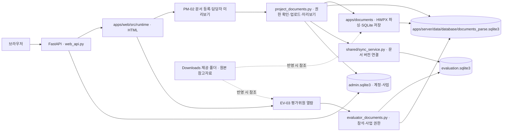

# 심사 서비스 상세 구성도와 실행 방법

이 문서는 현재 `apps/server`, `apps/web`, `apps/documents`, `apps/chatbot`으로 구성된 **단일 Python 서비스**를 설명합니다. `npm`이나 별도 Vite 서버 없이 FastAPI/Uvicorn이 화면과 API를 함께 제공합니다. 기본 포트는 `5190`이며 다른 서비스가 사용 중이면 `--port 5191`처럼 지정합니다. 실행 상태는 서버 프로세스에서 확인합니다.

김유진 변경파일의 EV-03·04·05 기능을 통합했고, 문서·챗봇 모듈 폴더 이름을 `documents`, `chatbot`으로 정리했습니다. 기능 범위와 당시 검증 기록은 [README](README.MD#평가위원-문서-열람비교도우미) 및 [검증 절](README.MD#확인한-동작과-검증-범위)을 참고하세요.

## 서비스 구성도

```mermaid
flowchart TB
    PY["macOS / Windows · Python 가상환경"] --> MODE["실행 방식"]
    MODE -->|로컬 테스트 로그인| DEMO["start_service.py · --local-test-login 자동 전달"]
    MODE -->|비데모| REAL["apps/server/run.py · --demo 없이 실행"]
    DEMO --> HOST["FastAPI / Uvicorn · apps/server/run.py"]
    REAL --> HOST
    USER["브라우저 · localhost:5190 또는 5191"] --> HOST
    HOST --> UI["apps/web/src/runtime · 기존 화면"]
    UI --> BIND["apps/web/src/screens · bindings"]
    UI --> EVUI["apps/web/src/evaluator · EV-03 / 04 / 05"]
    HOST --> STATIC["/src 정적 파일 · /fonts 글꼴"]
    HOST --> COMMITTEE["/committee-v2 · 위원회 화면"]
    BIND --> ACTIONS["/api/v2/actions · 기존 업무 API"]
    EVUI --> EVAPI["/api/v2/evaluator · 문서 API"]
    HOST --> ACTIONS
    HOST --> EVAPI
    ACTIONS --> AUTH["app/admin/auth_service.py · 세션·권한"]
    EVAPI --> AUTH
    ACTIONS --> CORE["app/admin · committee · evaluation"]
    EVAPI --> DOC["app/evaluation/documents · 열람·비교·질문"]
    DOC --> PARSED["apps/server/data/database/documents_parse.sqlite3 · 문서 저장·열람"]
    DOC --> CHAT["apps/chatbot/chatbot.py · AI 설정 시 사용"]
    CORE --> SHARED["app/shared · DB 접근·동기화"]
    DOC --> SHARED
    SHARED --> DBMODE["--data-dir · 데이터 폴더 선택"]
    DBMODE -->|데모| DEMODB["apps/server/data/database · 관리자·평가 DB / keys.bin"]
    DBMODE -->|비데모| REALDB["apps/server/data/production · 관리자·평가 DB / keys.bin"]
```



## 추가된 제안요청서 기능 구성도



업로드는 `POST /api/v2/projects/{id}/rfp`에서 처리합니다. 담당자 미리보기는
`/app/dept-admin/PM-02/design/rfp-preview.html`과 `/rfp/preview` API로
최신 업로드의 파싱 버전을 읽습니다. 평가위원용
`/app/evaluator/EV-03/design/rfp.html`은 평가 DB에 연결된 문서 버전을 읽고
로그인·사업·참석 권한을 검사합니다.

### 제공받은 폴더의 실행 필요 여부

| 폴더 | 실행 시 필요 여부 | 확인 근거 |
|---|---|---|
| `Downloads/5topilot_team-main_20261017/apps/web_cookiesh1/src/screens/dept-admin/PM-01-projects` | 불필요 | 파싱·저장 코드는 서비스 내부 `apps/documents`로 옮겼고 `project_documents.py`가 사용합니다. |
| `Downloads/5topilot_team-main_20261017/apps/web_cookiesh1/src/screens/evaluator/EV-03-rfp` | 불필요 | 실제 EV-03 HTML·JS·CSS는 서비스 내부 `apps/web/src/runtime`, `apps/web/src/evaluator`에서 제공됩니다. |
| 서비스 내부 `apps/web/src/screens/dept-admin/PM-01-projects` | PM-01 화면 사용 시 필요 | `design_runtime.py`가 이 폴더의 `binding.js`, `overview-binding.js`를 읽습니다. |
| 서비스 내부 `apps/web/src/screens/evaluator/EV-03-rfp` | 실행에는 불필요 | 현재는 README만 있으며 EV-03 동작 코드는 `apps/web/src/evaluator/EV-03`에 있습니다. |
| 서비스 내부 `apps/documents`, `apps/web`, `apps/server` | 해당 기능 실행에 필요 | 파서·저장 모듈은 `apps/documents`에 있고 서버의 `app/documents/__init__.py`가 기존 import를 새 위치로 연결합니다. |
| `apps/server/data/database/documents_parse.sqlite3` | 기존 업로드 문서 유지·열람에 필요 | 원본 파일과 파싱 결과, 업로드 버전이 이 DB에 저장됩니다. 새 빈 DB로 실행하면 기존 문서는 표시되지 않습니다. |

시작 코드와 화면·API 소스에는 Downloads 경로를 참조하는 import, 정적 파일 경로, 심볼릭 링크가 없습니다. `contracts/original_design_v2.json`의 `apps/web_cookiesh1` 문자열은 과거 시안 파일 목록이며 실행 코드에서 이 계약 파일을 읽지 않습니다. 따라서 제공받은 폴더는 원본 보관·추가 반영 작업에 쓰지만, **현재 통합 서비스를 구동할 때는 함께 둘 필요가 없습니다.**

이는 제공 폴더 전체의 기능이 이식되었다는 뜻은 아닙니다. 현재 연결된 범위는 HWPX 업로드·파싱·저장, 목차 추출과 제안요청서 열람이며, AI 요구사항·평가기준 생성 등은 별도 연결 상태를 확인해야 합니다.

### 요청과 데이터의 흐름

1. `/`은 역할 선택 화면인 `/app/entry/design/entry.html`로 이동합니다. `design_runtime.py`가 `apps/web/src/runtime`의 원본 화면에 `screens`와 `bindings`의 기능 코드를 연결합니다.
2. 로그인과 화면 버튼은 `/api/v2/actions/{action_id}`로 요청합니다. `web_api.py`가 요청·세션을 확인하고 `gateway.py` 또는 위원회 액션 게이트웨이를 통해 업무 함수에 전달합니다.
3. 관리자·위원회 기능은 주로 `admin.sqlite3`, 평가·결과 기능은 `evaluation.sqlite3`를 사용합니다. 두 DB 간 자료 전달은 `app/shared/sync_service.py`의 outbox/inbox 방식으로 처리합니다. `keys.bin`은 기존 암호화 데이터와 함께 유지해야 합니다.
4. `/committee-v2/`는 `apps/server/app/committee/web_v2`를 제공합니다. `/src`와 `/fonts`는 `apps/web`에서 제공합니다. 시안 폴더 `apps/web_cookiesh1/v2`는 서비스에 포함하지 않으며 `/v2/` 경로는 제공하지 않습니다.
5. EV-03·04·05는 기존 화면에 `/src/evaluator` 모듈을 연결합니다. `/api/v2/evaluator`는 기존 로그인 쿠키와 위원·사업·참석·회차 권한을 검사한 뒤 문서 DB의 고정 버전을 읽습니다. 별도 8002 서버나 Vite는 필요하지 않습니다. 점수와 의견 저장은 기존 액션 API를 유지합니다.
6. `/api/v2`의 `v2`는 API 버전 이름입니다. `apps/web_cookiesh1/v2` 시안 폴더는 서비스에 사용하지 않습니다. 데모와 비데모는 같은 화면·업무 코드를 사용하며, `--demo` 시드 실행 여부와 데이터 폴더가 다릅니다.

## 실행 파일 구조

```text
simsa-service-v0.1/
├── start_service.py                  # macOS·Windows 공통 실행기
├── start_simsa_v2.py                 # 이전 명령 호환 실행기
├── start_simsa_v2.cmd                # Windows 선택용 바로가기
├── SERVICE_ARCHITECTURE_AND_RUN.md  # 이 문서
└── apps/
    ├── web/
    │   ├── src/
    │   │   ├── runtime/             # 실제 HTML·CSS·JS 화면 · PM-02 미리보기 포함
    │   │   ├── screens/             # 화면별 기능 연결 · PM-02 미리보기 JS 포함
    │   │   ├── evaluator/           # EV-03·04·05 문서·비교 기능
    │   │   └── bindings/            # 공통 기능 연결
    │   └── public/
    │       ├── fonts/               # Pretendard GOV
    │       └── index.html           # 선택적 기본 화면
    ├── documents/
    │   ├── hwpx_parser.py          # HWPX 파싱
    │   ├── hwpx_storage.py         # SQLite 저장
    │   ├── rfp_toc.py              # 목차 쪽 연결
    │   ├── step3_ai_requirements_extract_to_SQLite.py
    │   └── requirements.txt        # 문서·AI 선택 의존성
    ├── chatbot/
    │   └── chatbot.py              # AI 답변 모듈
    └── server/
        ├── run.py                    # FastAPI 시작·데모 초기화
        ├── requirements.txt         # 실행 의존성
        ├── app/
        │   ├── api/                  # HTTP 라우팅·화면 연결 · project_documents.py
        │   ├── admin/                # 계정·부서·사업·대시보드
        │   ├── committee/            # 후보·선정·명부·위원회 화면
        │   ├── documents/            # 새 위치를 가리키는 import 연결
        │   ├── evaluation/           # 출석·평가·서명·결과
        │   └── shared/               # DB·데모 데이터·동기화·계약
        ├── contracts/               # 실행 시 읽는 스키마·액션 계약
        ├── fixtures/                # 초기 공통 데이터 SQL
        ├── migrations/
        │   ├── admin/               # 관리자·위원회 DB 변경
        │   └── evaluation/          # 평가 DB 변경
        └── data/
            ├── database/           # 데모 DB · v0.1 압축본에 포함
            │   ├── admin.sqlite3
            │   ├── evaluation.sqlite3
            │   ├── documents_parse.sqlite3 # 문서 파싱 DB · 원본·파싱 결과
            │   ├── projects_delete.sqlite3 # 삭제 사업 이력
            │   ├── keys.bin
            │   ├── access-code.txt
            │   └── sample-manifest.json
            └── production/         # 비데모 실행 시 생성 · 압축본 미포함
                ├── admin.sqlite3
                ├── evaluation.sqlite3
                ├── documents_parse.sqlite3
                ├── projects_delete.sqlite3
                ├── keys.bin
                └── access-code.txt
```

현재 작업 폴더에는 `artifacts/simsa-service-v0.1.zip`이 없습니다. 서비스는 이 작업 폴더에서 실행하며, 별도 배포본을 만들 때는 `apps/server`, `apps/web`, 필요한 `apps/documents` 데이터와 실행 파일을 함께 담아야 합니다. 현재 기본 데이터 폴더에는 로컬 테스트 관리자 계정 3개가 있고 사업은 없습니다.

## macOS·Windows에서 실행

Python 3.13이 설치된 컴퓨터에서 **서비스 프로젝트 루트**로 이동합니다. 기관 환경에서는 의존성 설치 전에 해당 패키지 게이트를 확인합니다. 가상환경은 컴퓨터마다 생성합니다.

macOS 터미널:

```bash
cd simsa-service-v0.1
python3 -m venv .venv
.venv/bin/python -m pip install -r apps/server/requirements.txt
.venv/bin/python start_service.py --port 5191
# 비데모: 데모 DB와 분리된 빈 데이터 폴더 사용
.venv/bin/python apps/server/run.py --port 5191 --data-dir apps/server/data/production
```

Windows PowerShell:

```powershell
cd simsa-service-v0.1
py -3.13 -m venv .venv
.venv\Scripts\python.exe -m pip install -r apps/server/requirements.txt
.venv\Scripts\python.exe start_service.py --port 5191
# 비데모: 데모 DB와 분리된 빈 데이터 폴더 사용
.venv\Scripts\python.exe apps/server/run.py --port 5191 --data-dir apps/server/data/production
```

위 명령 중 **한 가지 실행 방식만** 선택합니다. 브라우저에서 `http://127.0.0.1:5191/`을 열고, 실행 터미널에서 `Ctrl+C`로 종료합니다. 포트가 비어 있으면 `--port 5191`을 생략해 기본 포트 `5190`을 사용할 수 있습니다. 같은 데이터 폴더로 재실행하면 DB가 유지됩니다.

비데모 폴더는 처음 만들면 관리자·사업·위원 데이터가 모두 비어 있습니다. 계정과 업무 데이터를 등록해야 로그인 및 평가를 진행할 수 있습니다. `--demo`를 빼는 것만으로 운영 데이터나 배포 환경이 마련되는 것은 아닙니다. 문서 DB 기본 위치는 선택한 `--data-dir` 안의 `documents_parse.sqlite3`이며, 최초 통합 당시 평가 DB 문서 참조 3건과 파싱 버전이 일치하지 않았습니다.

### 실행 옵션

`start_service.py`는 현재 명령을 실행한 Python(`sys.executable`)으로 `apps/server/run.py`를 실행하며 `--local-test-login`을 전달합니다. 데모 사업은 생성하지 않고 현재 데이터 폴더에 저장된 로컬 테스트 계정의 로그인 입력만 돕습니다. 서버의 기본 포트는 `5190`, 데이터 폴더는 `apps/server/data/database`입니다. 프런트엔드는 같은 FastAPI 서버가 제공하므로 `npm run dev`는 필요하지 않습니다.

| 옵션 | 의미 |
|---|---|
| `--demo` | 명시적으로 전달할 때만 가상 계정·시연 사업 데이터를 생성합니다. |
| `--local-test-login` | 저장된 로컬 테스트 계정의 로그인 입력을 돕습니다. `start_service.py`가 자동으로 전달합니다. |
| `--original-ui` | `apps/web/src/runtime`의 원본 화면에 기능 코드를 연결합니다. 현재 서버의 기본값도 `True`라 명시하지 않아도 같습니다. |
| `--port 5190` | 로컬 서버 포트입니다. `--port 5191`처럼 변경할 수 있습니다. |
| `--data-dir 경로` | SQLite DB, `keys.bin`, `access-code.txt`를 저장·읽을 폴더입니다. 데모와 비데모 폴더를 분리합니다. 기존 데이터를 이동할 때는 DB와 키를 함께 유지합니다. |
| `--samples 경로` | 선택 사항인 샘플 문서 폴더입니다. 기본 실행에는 필요하지 않습니다. |
| `--documents-db 파일` | 문서 파싱·원본 저장 SQLite를 연결합니다. 생략 시 `EVAL_DOCUMENTS_DB_PATH`, 그다음 선택한 `--data-dir`의 `documents_parse.sqlite3`를 사용합니다. 상대 경로는 프로젝트 루트 기준입니다. |

PM-02 제안요청서 HWPX 업로드는 메인 서비스의 `/api/v2/projects/{id}/rfp`가 처리합니다. 원본·파싱 결과와 업로드 이력을 문서 DB에 저장하고, 평가위원용 고정 버전을 평가 DB에 연결합니다. 업체별 제안서, 목차 수정, AI 요구사항·평가기준 생성은 이 통합 화면에서 아직 연결되지 않았습니다.

과거 실행 코드에 있던 `os.execv(...)`는 현재 사용하지 않습니다. `start_service.py`는 운영체제별 Python 경로를 고정하지 않고 `sys.executable`과 `subprocess.run`을 사용합니다.

### 로컬 테스트 로그인

| 역할 | 계정 또는 이름 | 비밀번호 또는 휴대전화 뒤 4자리 |
|---|---|---|
| 총괄관리자 | `super-demo` | `DemoOnly!2026` |
| 사업담당자 | `web-demo` | `DemoOnly!2026` |
| 다른 부서 관리자 | `other-demo` | `DemoOnly!2026` |

이 세 계정은 현재 기본 데이터 폴더에 저장돼 있으며 `--demo` 없이 로그인할 수 있습니다. 평가위원 테스트 계정은 이번 초기화에서 제거됐습니다. DB와 `keys.bin`은 함께 유지해야 합니다.

## 확인한 동작과 검증 범위

2026-10-18에 데모 통합 테스트 6개와 실제 브라우저의 문서 열람·비교 흐름이 통과했습니다. 폴더 변경 후에도 같은 6개 테스트가 통과했고, 비데모 서버를 별도 빈 DB로 실행했을 때 `demo: false`, 첫 화면 HTTP 200, 두 DB 무결성 `ok`, 관리자·사업·위원 0건을 확인했습니다. 이후 제안요청서 업로드·담당자 미리보기 기능을 추가했고, 5191 서비스에서 업로드 문서 66쪽의 화면 표시를 확인했습니다. Windows 실제 실행은 아직 확인하지 않았습니다.

전체 `gg verify --run-tests`는 npm 테스트 명령 미설정과 Mac 가상환경의 `pytest` 미설치로 `blocked` 상태입니다. 개별 동작 확인은 운영 배포 검증을 뜻하지 않습니다.
