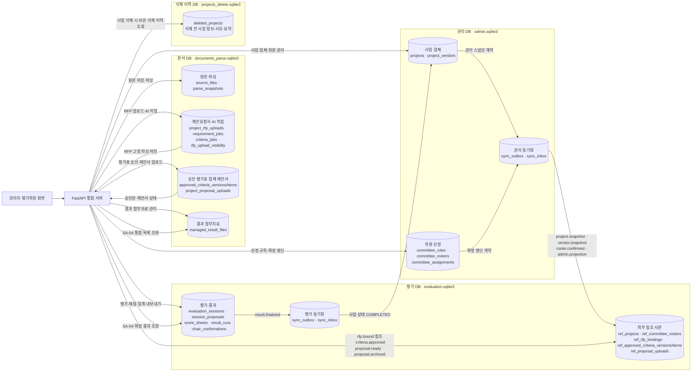
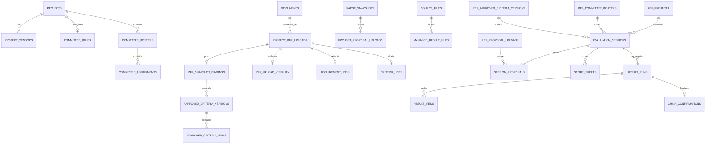

# 심사임당 DB 구성도 — 통합 코드 기준

작성일: 2026-10-18. 이 구성도는 2차 개발 내용을 메인 프로젝트에 통합한 **코드와 마이그레이션의 적용 후 구조**를 나타낸다. 아래의 현재 DB 상태 표를 함께 확인해야 한다.

## 1. DB 간 구성과 데이터 흐름

화살표는 **서버를 통한 데이터 전달**이다. 관리·문서·평가 DB는 서로 직접 조인하거나 외래키로 연결하지 않는다. 문서 DB의 `project_id`·`vendor_id`는 API가 관리 DB와 대조하고, 평가 DB는 계약으로 받은 `ref_*` 사본을 사용한다. 제안요청서 업로드는 현재 API가 평가 DB의 `ref_rfp_bindings`를 직접 갱신하며, 승인 평가표와 제안서 상태는 `apply_event` 계약을 사용한다. 삭제 이력 DB는 관리 DB와 연결된 한 트랜잭션에서 사업 정보 사본을 저장한다.

## 2. 핵심 테이블 관계

위 ERD는 핵심 관계만 표시한다. `PROJECTS`부터 `COMMITTEE_ASSIGNMENTS`까지는 관리 DB, `DOCUMENTS`부터 `MANAGED_RESULT_FILES`까지는 문서 DB, `REF_PROJECTS`부터 `CHAIR_CONFIRMATIONS`까지는 평가 DB다. 표시한 관계는 각 DB 내부의 연결이며, 세 DB 사이의 동일한 ID는 첫 번째 구성도의 계약으로 맞춘다. 별도 삭제 이력 DB의 `deleted_projects`는 다른 DB로 향하는 외래키가 없어 첫 번째 구성도에만 표시했다.

## 3. 이번 통합에서 바뀐 저장 규칙

| 영역 | 적용 후 내용 | 구현 위치 |
|---|---|---|
| 위원 정원 | `committee_rules.target_count`, `evaluation_sessions.target_count`의 DB CHECK를 **5~9명**으로 변경 | 관리·평가 DB의 `20261018_*_004.sql` |
| 예비위원 | 확정 명단의 **1~3명**을 `ROS-05`에서 검증. DB의 `reserve_count` CHECK 자체는 `>= 0` | `committee_roster.py` |
| 제안요청서 | 업로드 차수와 고정 파싱 버전을 저장. 보관 여부는 `rfp_upload_visibility`에 기록하고 최신본 조회에서 제외 | 문서 DB |
| 평가표 | `approved_criteria_versions/items`에 작업본·승인본과 근거 쪽을 저장. `criteria.approved`로 평가 DB 참조 사본을 생성 | 문서 → 평가 DB |
| 업체 제안서 | 업체별 업로드 차수·파싱 버전·상태를 저장. `proposal.ready`/`proposal.archived`로 평가 DB 상태를 동기화 | 문서 → 평가 DB |
| 결과 자료 | 원본 BLOB은 `source_files`, 첨부자료 버전은 `managed_result_files`에 저장. 점수·서명·최종 집계는 평가 DB에 유지 | 문서 DB / 평가 DB |
| 사업 삭제 | `projects_delete.sqlite3`에 삭제 전 정보·사유·요구사항 요약을 저장한 뒤 관리 DB의 사업·연결 행을 물리 삭제. 다른 사업에서 사용하지 않는 문서 원본·파싱 결과도 삭제. 평가 회차·문서 작업 진행 중에는 차단 | 관리 DB / 문서 DB / 삭제 이력 DB |

확정 결과의 XLSX는 `result_runs`·`result_items`·`score_sheets` 등을 읽어 생성한다. 파일 생성 자체가 새 결과 테이블을 추가하지는 않는다. 평가 DB는 `result.finalized`를 관리 DB로 전달해 사업 상태를 `COMPLETED`로 바꾼다. 동일 이벤트를 문서 DB 목적지로도 발행하지만, 현재 전달 루틴은 관리 DB 목적지만 처리한다. SA-04는 문서 DB 자료와 평가 DB의 확정 결과를 API에서 합쳐 조회한다.

## 4. 작업 폴더의 현재 DB 파일 상태

| DB 파일 | 2026-10-18 확인 결과 | 적용 시점 |
|---|---|---|
| `apps/server/data/database/admin.sqlite3` | 서비스 실행으로 `20261018_yujin_admin_004.sql` 적용됨. `committee_rules` 정원 CHECK는 **5~9명** | 2026-10-18 서버 시작 시 |
| `apps/server/data/database/evaluation.sqlite3` | 서비스 실행으로 `20261018_yujin_evaluation_004.sql` 적용됨. `evaluation_sessions` 정원 CHECK는 **5~9명** | 2026-10-18 서버 시작 시 |
| `apps/server/data/database/documents_parse.sqlite3` | 기존 RFP·파싱 DB를 같은 데이터 폴더로 이동. 추가 기능 테이블은 해당 기능을 처음 사용할 때 생성 | 해당 문서 기능의 초기화 또는 첫 사용 시 |
| `apps/server/data/database/projects_delete.sqlite3` | 기존 삭제 표시 사업 2건을 이관해 생성됨. 삭제 전 상태·삭제 사유는 과거에 저장되지 않아 ‘미기록’으로 표시 | 서비스 시작 시 기존 삭제 이력 이관, 이후 사업 삭제 시 추가 |

구성도 작성 당시에는 DB 파일을 변경하지 않았다. 이후 서비스 실행 요청에 따라 관리·평가 DB의 마이그레이션이 적용되었고, 두 DB 모두 `PRAGMA integrity_check` 결과 `ok`를 확인했다. 문서 DB의 새 테이블은 해당 기능의 초기화 또는 첫 사용 시 생성된다.
