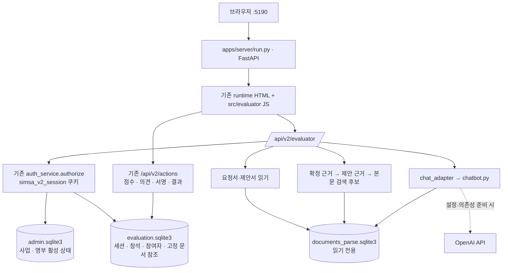

# 평가위원 문서 기능 통합 — 2026-10-18

## 반영 범위

김유진 변경파일의 문서 열람·비교·도우미 UI/API를 기존 5190 FastAPI 서버에 선택적으로 이식했다. 외부 변경파일 폴더는 실행 시 필요하지 않다. 별도 Vite·8002 서버·로그인 쿠키·평가 DB를 만들지 않는다.

| 구분 | 반영한 기능 | 저장 위치 |
|---|---|---|
| EV-03 | 요청서 본문·표·이미지, 제목 기반 목차, 쪽 이동, 원본 다운로드 | `apps/web/src/evaluator/EV-03` |
| EV-04 | 평가 시작 때 고정된 업체별 제안서 열람·원본 다운로드 | `apps/web/src/evaluator/EV-04` |
| EV-05 | 확정 평가항목별 비교, 근거 쪽 열기, 문서 질문 | `apps/web/src/evaluator/EV-05` |
| 공통 UI | 기존 화면 형태의 헤더·문서 뷰어·도우미, 기존 서비스 주소로 이동 | `apps/web/src/evaluator/common` |
| 통합 API | 기존 세션 인증, 요청 크기·JSON 확인, 오류 응답 | `apps/server/app/api/evaluator_documents.py` |
| 문서 기능 | 고정 문서 버전 조회, 비교 근거, 챗봇 연결, 다운로드 감사 기록 | `apps/server/app/evaluation/documents` |

기존 EV-00 로그인, EV-01 참석, EV-06 점수·서명, EV-07 결과는 기존 서비스가 담당한다. 들어온 `score_sheets.comment` 마이그레이션과 별도 인증·시드 서버를 반영하지 않았다. 기존 `score_sheet_opinions`와 점수 저장 액션을 유지한다.

## 구성도



## DB와 실행

- 관리자·평가 DB 기본 위치: `apps/server/data/database/admin.sqlite3`, `evaluation.sqlite3`.
- 암호화 키: 같은 폴더의 `keys.bin`. 기존 키와 DB를 함께 유지한다.
- 문서 DB 기본 위치: `apps/documents/documents_parse.sqlite3`. 이 통합 기능은 문서 DB를 생성·수정하지 않는다.
- 문서 경로 우선순위: `--documents-db` → `EVAL_DOCUMENTS_DB_PATH` 환경변수 → 기본 위치. 상대 경로는 저장소 루트 기준이다.

기존 가상환경의 Python으로 저장소 루트에서 실행한다. macOS는 일반적으로 `python3`, Windows 가상환경에서는 `python`이다.

```bash
python start_service.py
python start_service.py --documents-db "path/to/documents_parse.sqlite3"
```

외부 변경파일 폴더, v2 시안 폴더, 독립 평가위원 서버는 필요하지 않다. 본문 열람·비교는 현재 서버 의존성으로 동작한다. SVG 원본 렌더링은 선택 패키지 `pyhwpxlib`가 필요하며 없으면 파싱된 본문·표·그림을 표시한다. 제목 기반 목차는 원본의 인쇄 목차를 완전히 복원하지 않는다.

AI 답변은 기존 `apps/chatbot/chatbot.py`와 `apps/documents/step3_ai_requirements_extract_to_SQLite.py`, 해당 모듈의 `openai`·`tiktoken`·`python-dotenv`, `OPENAI_API_KEY` 설정이 필요하다. 이번 작업에서 패키지·버전을 추가하지 않았고 실제 AI 요청도 보내지 않았다. 미준비 상태는 화면 안내와 503 응답으로 처리한다. 채팅 질문·답변을 DB에 저장하지 않으며 감사 기록에는 업체와 글자 수 등만 기록한다.

## 데이터 연결 상태와 접근 제한

2026-10-18 확인 결과, 현재 서비스 DB의 요청서 참조 1건과 제안서 참조 2건이 문서 DB의 `(document_id, parse_revision)`과 모두 불일치한다. 따라서 기본 데이터에서 실제 문서가 보이는 상태는 아직 아니다. 기존 문서 승인·동기화 계약에 따라 같은 사업의 실제 문서 식별자와 버전을 전달해야 한다. 별도 샘플 문서를 임의로 업체에 연결하거나 현재 DB를 수정하지 않았다.

요청서는 해당 사업의 참석 확인 후, 제안서·비교·질문은 실제 참여자가 OPEN 이후 회차에서 사용할 수 있다. 다른 사업·회차·업체 또는 해당 평가에 연결되지 않은 이미지 접근을 거절한다. 확정·제안 근거도 고정 문서 식별자와 파싱 버전을 함께 검사한다. 기존 세션의 해제·명부 취소가 문서 API에도 적용된다.

## 검증 결과

임시 DB에서 실행한 독립 통합 테스트 6개가 통과했다. 로그인·로그아웃 공유, 권한 차단, 문서 조회·다운로드, 업체 선택, 본문 검색 근거, 기존 점수 저장, 문서 저장소 미준비, 채팅 어댑터 대체 응답을 확인했다. 실제 DB·키·평가 점수는 수정하지 않았다.

기존 문서 DB의 파싱 버전 3개·254쪽·최상위 블록 1,438개도 읽기 전용으로 조회하여 현재 파서 스키마와의 호환성을 확인했다. 이 확인은 실제 평가 사업에 문서를 연결했다는 의미가 아니다.

```bash
python apps/server/tests/evaluation/test_document_integration.py
```

별도의 임시 DB와 Chrome으로 로그인 → 요청서 파싱 대체 표시 → 업체 전환 → 항목별 비교 → 근거 쪽 열기 → 도우미 미준비 안내 → 기존 평가화면 복귀를 검증했다. 브라우저 JavaScript 예외는 0건이다. 테스트 서버와 브라우저는 검증 후 종료한다. 화면 캡처는 `artifacts/evaluator-integration/`에 있으며 테스트 전용 가상 문서이다.

```bash
python apps/server/tests/evaluation/run_document_browser.py
```

브라우저 테스트는 설치된 Chrome을 사용한다. Windows·다른 설치 경로에서는 `CHROME_BIN`으로 실행 파일을 지정한다. 실제 검증은 macOS에서 수행했으며 Windows 실기기 검증은 하지 않았다.

`gg verify --run-tests`는 **blocked**: npm 테스트 명령 미설정, Python 환경의 pytest 미설치. 개별 검증 통과는 프로젝트 전체 검증 통과를 의미하지 않는다. 기존 ZIP 배포본은 이번 코드 변경을 포함하지 않는다.

기존 문서 모듈에 선언된 `openai==3.23.0` 설치 게이트도 실행했지만 `incomplete`(검사기 부재) 판정이다. 따라서 AI 관련 패키지를 새로 설치하지 않았다. 증적: `evidence/2026-10-17T15-57-28-773Z-package-check.json`, `evidence/2026-10-17T15-57-30-236Z-verify.json`.
